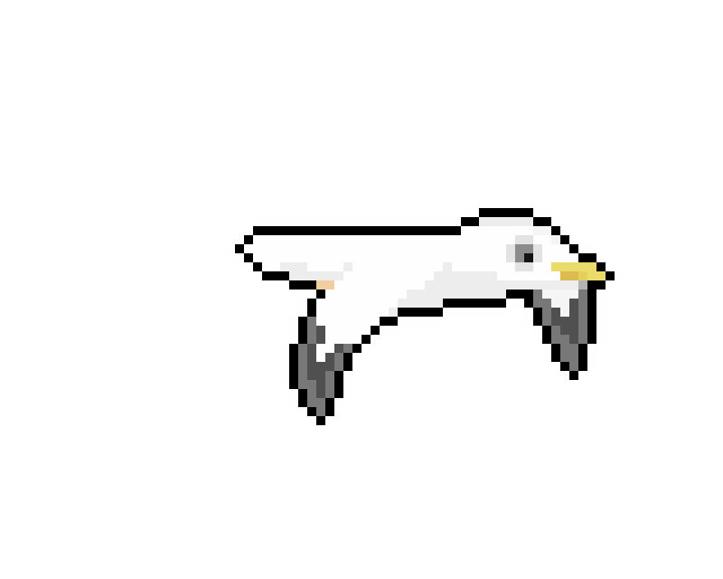

```
  ██████╗██╗  ██╗██╗██████╗ ██╗██╗   ██╗ █████╗     ██╗   ██╗██████╗ ██████╗ 
 ██╔════╝██║  ██║██║██╔══██╗██║╚██╗ ██╔╝██╔══██╗    ██║   ██║██╔══██╗██╔══██╗
 ██║     ███████║██║██║  ██║██║ ╚████╔╝ ███████║    ██║   ██║██║  ██║██║  ██║
 ██║     ██╔══██║██║██║  ██║██║  ╚██╔╝  ██╔══██║    ██║   ██║██║  ██║██║  ██║
 ╚██████╗██║  ██║██║██████╔╝██║   ██║   ██║  ██║    ╚██████╔╝██████╔╝██████╔╝
  ╚═════╝╚═╝  ╚═╝╚═╝╚═════╝ ╚═╝   ╚═╝   ╚═╝  ╚═╝     ╚═════╝ ╚═════╝ ╚═════╝ 
                                                                               
                     🐦 THE LEGENDARY BIRD BRAIN GAME 🐦
```

<div align="center">
  
</div>

# 🎮 CHIDIYA UDD - A Retro Revival

> *"A childhood classic from the Indian streets, now reimagined as a fast-paced multiplayer brain-teaser with retro pixel vibes."*

---

## 📖 The Story

Back in the 2000s, Indian playgrounds echoed with the sound of "CHIDIYA UDD!" - a simple yet addictive game where kids tested their knowledge. One player would call out an animal or object, and others had **milliseconds** to decide: **DOES IT FLY?**

Now, decades later, we've brought this classic back to life.

**Chidiya Udd** is a lightning-fast quiz game where you compete in **real-time multiplayer battles**. Call out entities, make split-second decisions, and prove you're the ultimate Chidiya expert!

- 🏃 **Millisecond Reflexes** - Make decisions in milliseconds or lose a heart
- 🎯 **Streak Multiplier** - Get consecutive answers right to multiply your score
- 👥 **Real-Time Multiplayer** - Play with friends instantly (no waiting!)
- 🕹️ **Retro Aesthetic** - Pixel-perfect UI inspired by 8-bit gaming
- 🗣️ **Hindi Narration** - Hear entity names pronounced in Indian accent
- 📱 **Fully Responsive** - Play on phone, tablet, or desktop

---

## 🎮 How to Play

### Single Player
1. Click **"SINGLE PLAYER"**
2. An entity appears on screen
3. **FLY?** → Tap the **FLY!** button
4. **NOT FLYING?** → Wait (don't tap!)
5. Get it right = +10 points (×streak multiplier)
6. Get it wrong = -1 ❤️
7. Game over when you lose all 3 hearts

### Multiplayer
1. Click **"MULTIPLAYER"** (requires Google login)
2. **HOST**: Create a room → Share room code
3. **PLAYER**: Join room with code
4. Host starts the game
5. Same rules, but compete **live** against friends!
6. See real-time scores on the leaderboard
7. Last one standing wins! 🏆

---

## 🔗 Links

- **GitHub**: https://github.com/Chaitaneya/chidiyauddd
- **Play Live**: https://chidiya-udd.vercel.app (coming soon)
- **Report Issues**: GitHub Issues

---

## 📋 Features

| Feature | Status |
|---------|--------|
| Single Player Mode | ✅ |
| Multiplayer (Real-time) | ✅ |
| Google Authentication | ✅ |
| Retro Pixel UI | ✅ |
| Responsive Design | ✅ |
| High Score Encryption | ✅ |
| Session Timeout Security | ✅ |
| Sound Effects | ✅ |
| Mobile Optimized | ✅ |

---

## 🛠️ Tech Stack

```
Frontend:    React 19 + TypeScript + Vite
Styling:     Tailwind CSS
Backend:     Supabase (Realtime + Auth)
Auth:        Google OAuth 2.0
Hosting:     Vercel 
Realtime:    Supabase
```

---

## 📦 Project Structure

```
components/
  ├── screens/       ← Full-page views (MainMenu, GameScreen, etc.)
  ├── common/        ← Reusable UI components (Button, Logo, etc.)
  └── modals/        ← Dialog modals (LoginModal)
services/          ← Business logic (auth, multiplayer, audio)
contexts/          ← Global state management (UserContext)
utils/             ← Helper functions (encrypted storage)
public/            ← Static assets (images, sounds)
docs/              ← Documentation (setup, deployment, security)
```

---

## 🔐 Security Features

✅ Encrypted high score storage  
✅ 30-minute session timeout  
✅ Input validation (XSS prevention)  
✅ Rate limiting on realtime broadcasts  
✅ CORS & CSP security headers  
✅ Error boundary component  
✅ OAuth redirect validation  

---


## 👥 Contributing

Found a bug? Want to add a feature? Please open an issue or submit a PR!

---

## 🎯 Credits

Originally inspired by the childhood game "Chidiya Udd" from Indian playgrounds.  
Modernized and reimagined for the web with love for retro gaming.

**Made with ❤️**

---

```
╔═══════════════════════════════════════════════════════════════╗
║  CHIDIYA UDD - Relive the Childhood Classic                  ║
║  Does it FLY? 🐦 You decide in milliseconds!                 ║
╚═══════════════════════════════════════════════════════════════╝
```
